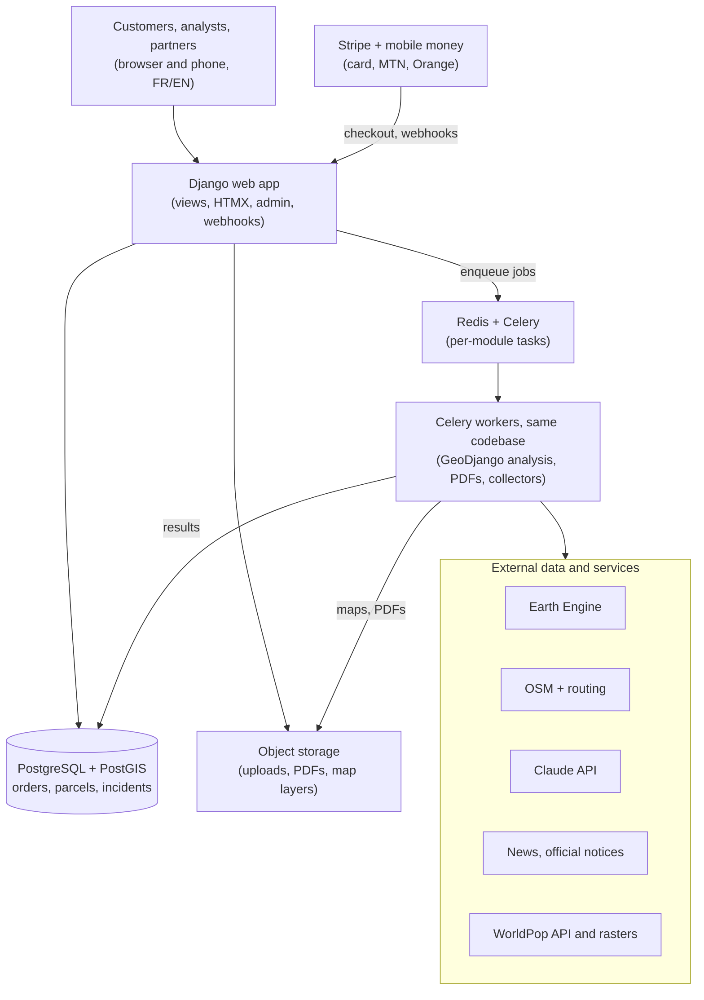

# Land Due-Diligence Report Platform — Technical Requirements

Oct 25, 2026 · Derrick Demeveng

## 1. Purpose and scope

Build a bilingual (French/English) web platform that sells physical and environmental due-diligence reports on land parcels in Cameroon to remote buyers, mainly the diaspora. A buyer submits a parcel, pays, and receives a reviewed PDF report plus an online map view.

The MVP is a **service with software behind it**, not a self-serve analytics platform. Every report passes through a human review step before delivery. Automation grows only where reviews show repeated manual work.

**What a report answers**

- Is the parcel where the seller says it is, and does it match what is on the ground?
- Is it occupied, built on or cleared, and how has that changed over 5–10 years?
- Is it exposed to flooding, steep slopes or erosion?
- How accessible is it, and how far is it from roads, schools, clinics, markets and water?
- Who lives around it, and how fast is the area growing?
- Are there physical or regulatory red flags (setbacks, protected areas, public-utility zones)?
- Have land issues been reported online in the surrounding area?

**In scope for the MVP**

- Public marketing site with sample reports and pricing
- Parcel intake (map pin, drawn polygon, coordinates file or uploaded site plan)
- Card and mobile-money payments
- Customer account to track orders and download reports
- Automated geospatial analysis pipeline
- Land-issues incident database and area-signals section
- Admin back office for review, editing and delivery
- Optional field-verification upsell fulfilled by partner surveyors and notaries

**Out of scope for the MVP**

- Legal title verification. The report must never state or imply that a title is valid.
- Property listings, marketplace or buyer–seller matching
- Native mobile apps
- Public API
- Coverage outside Cameroon

## 2. Users, roles and journeys

Four roles share one application; access is enforced server-side by role.

| Role | Who | Can do |
| --- | --- | --- |
| Customer | Diaspora buyer, local buyer, agent | Create orders, pay, upload documents, view own reports, request field verification |
| Analyst | The founder or a hired analyst | Review pipeline output, edit report text, approve and deliver, manage incidents |
| Partner | Surveyor (géomètre) or notary | View assigned field jobs, upload photos, GPS points and findings |
| Admin | The founder | Everything above, plus pricing, users, partners, payouts and settings |

**Journey A — desk report**

1. Customer lands on the site, reads a sample report, picks a tier.
2. Customer locates the parcel: drops a pin, draws the boundary, uploads a KML/GeoJSON/CSV of corner coordinates, or uploads a photo or PDF of the seller's site plan.
3. Customer adds context: seller-stated area, quartier, commune, intended use, deadline.
4. Customer pays by card or mobile money and receives a confirmation email.
5. The pipeline runs automatically and creates a draft report.
6. An analyst reviews, edits and approves the draft.
7. Customer gets an email with a link; the PDF and the interactive map are available in their account.

**Journey B — site plan only**

If the customer uploads only a scanned plan, the order enters a "needs georeferencing" state. The analyst digitizes the boundary in the admin map editor, and the pipeline runs once the geometry is saved.

**Journey C — field verification upsell**

1. Customer buys the field tier upfront or upgrades after reading the desk report.
2. Admin assigns a partner in the right region.
3. Partner visits, uploads geotagged photos, boundary-marker GPS points and a findings form, and attaches any registry search results.
4. Analyst merges the field findings into a revised report version and redelivers it.

**Journey D — bulk client**

An agency or notary uploads a CSV of parcels and is invoiced monthly. This comes after the MVP, but the data model must support an organization owning many orders.

## 3. Public site, intake, payments and customer portal

**3.1 Public site**

- FR-1: Pages for Home, How it works, Sample reports (2–3 downloadable PDFs), Pricing, FAQ, About, Contact, Terms, Privacy and the report disclaimer.
- FR-2: Every page in French and English, with a language switcher and locale-prefixed URLs (`/fr/...`, `/en/...`). Default language comes from the browser, and the user's choice persists.
- FR-3: Prices shown in the visitor's chosen currency (XAF, CAD, EUR, USD) from a price table set by the admin. They are not live FX conversions.
- FR-4: A WhatsApp contact button and a lead-capture form. The diaspora audience lives on WhatsApp.
- FR-5: SEO basics: per-page meta tags in both languages, sitemap, Open Graph images.

**3.2 Parcel intake**

- FR-6: Multi-step order form: (1) locate the parcel, (2) parcel details, (3) choose tier and add-ons, (4) account and contact, (5) pay.
- FR-7: Locating supports four inputs: map pin with search by place name, drawing a polygon on satellite basemap, uploading KML, KMZ, GeoJSON, GPX, SHP (zipped) or CSV with lat/lon or UTM coordinates, and uploading a site plan image or PDF.
- FR-8: Coordinate inputs accept WGS84 and UTM zones 32N and 33N, which cover Cameroon. Validate that the geometry falls inside Cameroon and has a plausible size, between 50 m² and 500 ha; warn rather than block outside that range.
- FR-9: A pin-only order is analysed with a default 30 m buffer and flagged in the report as "approximate location".
- FR-10: Parcel details: seller-stated area, quartier, commune, region, land title number if any (stored, never verified), intended use, notes, and attachments of photos and documents, up to 20 MB each.
- FR-11: Show the customer the drawn geometry, computed area and the seller-stated area side by side before payment. Highlight a difference above 10%.

**3.3 Payments**

- FR-12: Card payments through Stripe Checkout.
- FR-13: MTN Mobile Money and Orange Money through a Cameroon-capable aggregator behind a common payment interface, so providers can be swapped.
- FR-14: An order moves to "paid" only on a verified provider webhook, never on a client-side redirect. Webhooks are idempotent.
- FR-15: Discount codes (percentage or fixed, expiry, usage limit) and manual "mark as paid" for bank transfers, admin only.
- FR-16: Automatic receipts by email; refunds are triggered from the admin and recorded on the order.

**3.4 Customer portal**

- FR-17: Sign-up and sign-in by email magic link or password, plus Google sign-in. An account is created during checkout if needed.
- FR-18: An order list showing status: Submitted, Paid, Needs georeferencing, Processing, In review, Delivered, Field visit scheduled, Field report delivered, Refunded.
- FR-19: A report page with an interactive map of the parcel and analysis layers, report sections and PDF download. Report links can be shared with an expiring, revocable token.
- FR-20: Customers can message the analyst on an order and upgrade to field verification.
- FR-21: Email notifications on every status change, in the customer's language.

## 4. Analysis pipeline and report contents

Payment confirmation enqueues one analysis job per parcel. Each module below runs independently and writes its own result record, so one failing module never blocks the others or the analyst. A full desk run should finish in under 15 minutes.

| Module | What it computes | Main inputs |
| --- | --- | --- |
| Location check | Computed area vs stated area; centroid, admin units (region, department, arrondissement, commune); nearest named quartier | Parcel geometry, admin boundaries, quartier gazetteer |
| Current imagery | Recent cloud-free true-colour image of the parcel and a 500 m surround | Sentinel-2 L2A composite; licensed high-resolution imagery where available |
| Occupation and change | Built-up, vegetation and bare-soil share inside the parcel; new buildings and clearing year by year over 5–10 years | Sentinel-2 time series (NDVI, NDBI), Google Open Buildings temporal layer, GHSL built-up |
| Buildings on parcel | Count and footprint area of detected buildings inside and within 20 m of the boundary | Google Open Buildings, OSM buildings |
| Flood and water | Distance to nearest river, wetland or permanent water; share of parcel ever observed as water; height above nearest drainage; flood-hazard class | JRC Global Surface Water, HydroSHEDS/MERIT Hydro, Copernicus or FABDEM elevation, a flood hazard model |
| Terrain | Mean and max slope, elevation, erosion-risk flag above a configurable slope | Copernicus DEM / FABDEM |
| Access and services | Distance and travel time to nearest paved road, school, health facility, market, water point; whether the parcel touches a road | OSM extract, health facility master list, routing engine |
| Demographics and growth | Population totals, age-sex pyramid, growth trend, density and age-group indicators for 1 km, 5 km and the commune; built-up change (section 4.1) | WorldPop stats API and WorldPop age-sex rasters, GHSL |
| Regulatory red flags | Overlap or proximity to protected areas, riverbank and road setback buffers, known public-utility (DUP) and infrastructure corridors | Protected-area layer, configurable setback rules, admin-maintained DUP layer |
| Area signals | Land-issue incidents near the parcel (section 5) | Incident database |

**4.1 Demographics module (WorldPop)**

The module describes the people living around the parcel, not on it. A single parcel holds too few people for a reliable estimate.

- FR-52: Analysis areas are a 1 km and a 5 km buffer around the parcel, plus the commune. Totals are reported for all three; the pyramid for the 5 km buffer, with the commune as comparison.
- FR-53: Historical series 2000–2020 come from the WorldPop stats API at `api.worldpop.org/v1/services/stats`, using dataset `wpgppop` for totals and `wpgpas` for age-sex structure. Requests are asynchronous: submit the polygon, store the task ID, and poll `api.worldpop.org/v1/tasks/{taskid}` with backoff.
- FR-54: Validate the GeoJSON request format against the live API during development, simplify geometries before sending, use an API key, and stay within WorldPop's fair-use limits. Wrap all calls in a `PopulationProvider` interface.
- FR-55: The stats API stops at 2020. For recent years and projections, download WorldPop's newer global age-sex rasters for Cameroon once, store them as COGs, and compute zonal statistics in the worker. Record the release name and year range of every figure.
- FR-56: Cache results by geometry hash, dataset, release and year. Commune results are computed once and reused across orders.
- FR-57: Outputs:
  - Population pyramid: 5-year bands, male left and female right, as a share of total, with the commune outline overlaid.
  - Growth trend: a line of total population per year, average annual growth rate for the last 5 and 10 years, and projected years drawn dashed.
  - Density in people per km² for each analysis area.
  - Age-group indicators: under 5, 5–14 (school age), 15–64, 65+, and dependency ratio.
- FR-58: A traffic-light growth rating uses admin-editable thresholds on the annual growth rate. Finding sentences come from bilingual templates, for example: "About {n} people live within 5 km. The population grew {r}% a year from {y1} to {y2}. {s}% are under 15."
- FR-59: Charts are rendered server-side as SVG for the PDF and as interactive charts in the portal, from the same stored results.
- FR-60: Where two WorldPop releases meet, the chart marks the break and does not splice the series silently.
- FR-61: The section states that figures are modelled estimates, not census counts, and are less certain for small areas.
- Acceptance: for any area and year, the age-sex bands sum to the reported total within rounding, and every figure shows its WorldPop release.

**Rules for every module**

- Store inputs, dataset versions, parameters and the run timestamp so any report can be reproduced.
- Output a status (ok, warning, failed), numeric results, map layers (GeoJSON or COG) and a static map image for the PDF.
- Express each result as a finding with a traffic-light rating (green, amber, red, grey for unknown). Thresholds live in an admin-editable config, not in code.
- Generate the plain-language finding text from templates in both languages. Do not let an LLM invent findings; an LLM may only rephrase within the analyst review step.

**Report structure (PDF and web)**

1. Cover: parcel reference, location, order date, report version, tier.
2. Summary: one page of traffic-light findings, each with one sentence.
3. Location and boundary check, with map and area comparison.
4. Current imagery and occupation.
5. Change over time: image strip by year and a chart of built-up and vegetation share.
6. Flood, water and terrain.
7. Access and services, with a nearby-services map and table.
8. Demographics and area growth: population pyramid, growth trend, density.
9. Regulatory red flags.
10. Area signals: reported land issues nearby.
11. Field verification findings (field tier only).
12. Methods, data sources with dates, limitations and the disclaimer.

**PDF requirements**

- A4, branded, both languages from one template; the customer picks the language and can download the other.
- Every map has a north arrow, scale bar, legend, imagery date and attribution.
- A unique report ID and QR code on every page that links to a verification page confirming the report is genuine and unaltered (via a stored hash).
- Versioned: a re-issued report keeps prior versions visible to the admin.

**4.2 Maps, charts and visuals**

Every number in the report is backed by a map, chart or image, and every visual states its finding in its title. The report should be understandable from its visuals alone.

| Report section | Visual | Type | What it shows |
| --- | --- | --- | --- |
| Cover | Locator map | Map with inset | Cameroon, region and commune, with the parcel marked |
| Cover | Hero image | Satellite image | Latest imagery of the parcel with its boundary |
| Summary | Scorecard | Tiles | One tile per finding: icon, rating colour, label and the key number |
| Summary | Context map | Map | Parcel, roads, water and nearest services at 1 km |
| Location | Boundary map | Map on imagery | Boundary, numbered vertices, edge lengths in metres, coordinates table |
| Location | Area check | Bar chart | Seller-stated area vs computed area, difference in % |
| Occupation | Land cover | Stacked bar | Built-up, vegetation and bare share inside the parcel |
| Occupation | Buildings map | Map on imagery | Building footprints inside and within 20 m of the boundary |
| Change over time | Image strip | Small multiples | One image per year, same extent and scale |
| Change over time | Cover trend | Stacked area chart | Built-up, vegetation and bare share by year |
| Change over time | Change map | Map | New buildings and clearing coloured by year detected |
| Flood and water | Water occurrence | Map | Surface-water frequency and rivers within 1 km |
| Flood and water | Flood hazard | Map | Hazard class and height above drainage around the parcel |
| Terrain | Elevation profile | Line chart | Cross-section through the parcel along its longest axis |
| Terrain | Slope map | Map | Slope classes with the erosion threshold highlighted |
| Access | Isochrone map | Map | 5, 10 and 15-minute walk and drive areas, with services |
| Access | Travel times | Horizontal bar chart | Time to nearest road, school, clinic, market, water point |
| Demographics | Density map | Map | People per km² within 5 km |
| Demographics | Population pyramid | Pyramid chart | Age-sex shares, 5 km buffer vs commune |
| Demographics | Growth trend | Line chart | Population by year, projections dashed, release break marked |
| Demographics | Age groups | Grouped bar chart | Under 5, 5–14, 15–64, 65+: 5 km vs commune |
| Demographics | Urban expansion | Map | Built-up area by epoch within 5 km |
| Red flags | Constraints map | Map | Setback buffers, protected areas and public-utility corridors over the parcel |
| Area signals | Incident map | Map | Incidents by type symbol within the search radius |
| Area signals | Incident timeline | Dot timeline | Incidents by year and type |
| Field verification | Photo map | Map + photo grid | Numbered photo locations and boundary markers, with the photos |

**Design rules**

- FR-62: Maps use three standard extents, so readers compare like with like: parcel (boundary plus 50 m), neighbourhood (1 km) and area (5 km). The parcel symbol is the same on every map.
- FR-63: Every map has a title stating the finding, north arrow, scale bar, legend, imagery or data date, and attribution. Every chart has a finding title, labelled axes with units, and its source and year beneath.
- FR-64: Use colour-blind-safe palettes. Ratings are shown with colour plus an icon and a word, never colour alone.
- FR-65: Visuals print legibly on A4 at 300 dpi in colour and in greyscale. Maps and charts are vector (SVG/PDF) where possible; imagery at a resolution where the boundary is clearly visible.
- FR-66: One chart specification per visual drives both the PDF and the portal. Use Vega-Lite for charts; render static maps server-side and show the same layers in MapLibre in the portal, where they are interactive (hover values, toggle layers, swipe between imagery years).
- FR-67: Visual styles (colours, fonts, extents, symbols) live in a shared style config, not inside each chart.
- FR-68: When data for a visual is unavailable, show a labelled placeholder explaining why, rather than dropping the visual.
- Acceptance: every figure in the summary scorecard appears in at least one map or chart in its section, and every visual carries a source and date.

## 5. Land-issues incident database and area signals

Reports draw land-issue history from a curated, geocoded database that grows continuously. They do not run a live web search per order. This keeps results consistent, reviewable and fast.

**5.1 Collection**

- FR-22: Scheduled collectors (daily) pull candidate items from configured sources: RSS feeds and site pages of Cameroonian news outlets, official communiqués and gazette notices, and news search alerts on a configurable keyword list in French and English (for example *litige foncier*, *double vente*, *titre foncier annulé*, *casse*, *déguerpissement*, *expropriation*, *déclaration d'utilité publique*, *land dispute*, *eviction*).
- FR-23: Admins can add a source (URL, type, language, crawl frequency), pause it, and add an item manually by pasting a URL or uploading a PDF notice.
- FR-24: Collectors must respect robots.txt and site terms. No scraping of social networks or login-protected pages.
- FR-25: Store the source URL, title, publication date, outlet, retrieval date and a content hash for deduplication. Store full text only where needed for extraction, keep it private, and never show it to customers.

**5.2 Extraction and geocoding**

- FR-26: An LLM extraction step turns each item into zero or more structured incidents: incident type, place names mentioned, date of event, short neutral summary in FR and EN (max 40 words, written fresh, not copied), whether an official act is involved, and an extraction confidence score.
- FR-27: Incident types: title cancellation or withdrawal; expropriation or public-utility declaration; demolition or eviction campaign; double sale or fraud allegation; boundary or inheritance dispute; customary versus registered land conflict; encroachment on public land; other.
- FR-28: Geocode place names against a Cameroon gazetteer of quartiers, villages and lieux-dits maintained in the database. Unmatched names go to a review queue where an analyst can map them and add aliases.
- FR-29: Every incident records its location precision: point, quartier polygon, commune, or department. Incidents above commune level never appear in a parcel's area-signals section.

**5.3 Review**

- FR-30: New incidents start as "unreviewed" and are shown to customers only after an analyst approves them. Analysts can edit, merge duplicates, reject, or mark an item as an official act.
- FR-31: Personal names of private individuals are stripped from summaries during extraction and blocked at review. Names of public bodies and officials acting in office may remain.

**5.4 Use in reports**

- FR-32: For each parcel, list approved incidents in the same quartier or within a configurable radius (default 2 km), newest first, over the last 10 years by default.
- FR-33: Each entry shows date, type, location precision, the neutral summary and a link to the source. Official acts are listed first and labelled.
- FR-34: The section always includes a fixed statement in both languages that these are area-level public reports, are not findings about this parcel or its owners, and that no results does not mean the area is free of disputes.
- FR-35: An admin map view of all incidents, filterable by type, date and status, doubles as an internal market-intelligence tool.

## 6. Admin back office, review workflow and partners

**6.1 Order management**

- FR-36: A queue of orders by status, with filters for tier, region, deadline and age, and a flag on orders past their service-level target (desk report: 3 business days).
- FR-37: An order detail page with the customer's inputs, attachments, payment record, message thread, pipeline status per module and an audit log.

**6.2 Georeferencing and geometry editing**

- FR-38: A map editor over satellite basemap to draw or edit the parcel boundary, snap vertices, and type coordinates.
- FR-39: Overlay an uploaded site plan image on the map with control points (at least 3) to georeference it, then trace the boundary.
- FR-40: Saving a new geometry reruns the affected modules and keeps the previous geometry in history.

**6.3 Report review**

- FR-41: A side-by-side view: generated findings and ratings on one side, maps and layers on the other.
- FR-42: Analysts can override a rating with a required reason, edit finding text in both languages, add an analyst note, hide a section with a reason, and rerun single modules.
- FR-43: An optional "suggest wording" button may call an LLM to improve the clarity of the analyst's text; the analyst must accept each suggestion.
- FR-44: Approval generates the final PDF, stores its hash, notifies the customer and locks the version. Changes after delivery create a new version.

**6.4 Partners and field verification**

- FR-45: A partner directory with name, profession, registration number, regions covered, rates and status.
- FR-46: Assign a field job with a brief, the parcel map, a checklist and a due date; the partner accepts or declines.
- FR-47: A mobile-friendly partner form to upload geotagged photos, GPS points of boundary markers, occupancy and access observations, neighbour statements, and scanned registry search results. Photos keep their EXIF location and time, and the system flags photos taken more than 200 m from the parcel.
- FR-48: Track partner fees and payout status per job.

**6.5 Settings and content**

- FR-49: Admin-editable prices per tier and currency, rating thresholds, setback rules, report text templates (FR/EN), email templates and the disclaimer.
- FR-50: Admin-maintained layers: quartier gazetteer, public-utility and infrastructure corridors, and any custom risk zones, uploaded as GeoJSON or shapefile.
- FR-51: A simple dashboard: orders, revenue by currency and tier, average turnaround, conversion from desk to field, and incidents added per week.

## 7. Architecture, stack and data

One Django project does everything: web processes serve users, and Celery workers run the geospatial and extraction jobs from the same codebase, against one PostgreSQL/PostGIS database.

Payment webhooks and user actions land in Django views, which enqueue Celery tasks; workers write results back through the same Django models and save files to storage.

**7.1 Stack**

| Layer | Choice | Notes |
| --- | --- | --- |
| Web framework | Django 5 with GeoDjango | Server-rendered templates; Django i18n (`i18n_patterns`) for FR/EN URLs and strings; django-modeltranslation for bilingual database content |
| Front-end interactivity | HTMX + Alpine.js, Tailwind CSS | No separate single-page app; JavaScript only where maps and charts need it |
| Maps in browser | MapLibre GL JS, Terra Draw for drawing | Satellite basemap from a provider whose terms allow commercial use |
| Charts | Vega-Lite: vega-embed in the browser, vl-convert server-side | One spec per chart for the portal and the PDF |
| Auth | django-allauth (email and password, login by email code, Google) | Roles as Django groups and permissions |
| Back office | Customized Django admin + a few custom staff views | Admin for orders, incidents, partners, settings, prices; custom views for report review and site-plan georeferencing |
| Database | PostgreSQL 16 + PostGIS 3 | Single source of truth; reuse patterns from TerraCam |
| Background jobs | Celery + Redis, django-celery-beat for schedules | Per-module tasks with retries and backoff; daily collectors |
| Geospatial | Earth Engine Python API, GeoPandas, Rasterio, Shapely, GDAL via GeoDjango | GEE via a service account |
| Routing | OSRM or Valhalla on a Cameroon OSM extract | Self-hosted container |
| PDF | WeasyPrint rendering Django templates | Report page and PDF share template partials |
| LLM | Claude API for incident extraction and optional wording help | Structured JSON output, validated against a schema |
| Internal API | django-ninja or Django REST Framework | JSON for portal maps and charts, payment webhooks |
| Files | django-storages + S3-compatible storage (e.g. Cloudflare R2) | Private bucket, signed URLs |
| Payments | Stripe + a Cameroon mobile-money aggregator | Behind a `PaymentProvider` interface |
| Email | django-anymail with Postmark or Resend | Bilingual templates |
| Hosting | Docker Compose on one VPS: Nginx, Gunicorn, Celery worker, Celery beat, Postgres, Redis | Daily DB backups, off-site |
| Static files | WhiteNoise or Nginx, compressed assets, a CDN | Meets the 3G page-load target |
| Monitoring | Sentry, uptime checks, structured logs, Flower for Celery | Alert on failed tasks and webhooks |

**7.2 Core data model**

Organize the code as Django apps by domain: `accounts`, `orders`, `parcels`, `payments`, `analysis`, `reports`, `incidents`, `gazetteer`, `partners` and `core` (settings, audit log). The main models:

- `organizations`, `users` (role, language, currency)
- `orders` (status, tier, add-ons, prices, deadline, organization)
- `parcels` (geometry `MultiPolygonField(srid=4326)`, input method, stated area, computed area, quartier, commune, title number as text, geometry history)
- `attachments` (order, type, storage key, EXIF location)
- `payments` (provider, provider reference, amount, currency, status, raw webhook)
- `analysis_runs` and `module_results` (module, status, parameters, dataset versions, results JSON, layers, rating)
- `reports` and `report_versions` (language, content JSON, PDF key, hash, approved by, approved at)
- `sources`, `source_items` (URL, hash, dates, private text), `incidents` (type, event date, summaries FR/EN, geometry, precision, official act flag, confidence, review status), `incident_sources`
- `gazetteer_places` (name, aliases, type, geometry, admin units)
- `reference_layers` (DUP corridors, custom risk zones, setback rules)
- `partners`, `field_jobs`, `field_observations`
- `messages`, `audit_log`, `settings`

**7.3 Data sources and licensing**

Every dataset must be checked for commercial-use terms before it ships in a paid report. Record each dataset's licence and required attribution in a `datasets` table that the report's Sources section reads from.

- Generally usable with attribution: Sentinel-2 (Copernicus), JRC Global Surface Water, Copernicus DEM, WorldPop (CC BY 4.0, cite the release used), GHSL, OpenStreetMap (ODbL), HydroSHEDS, Google Open Buildings (check current terms), geoBoundaries / HDX admin boundaries.
- Restricted, verify or replace: WDPA protected areas (non-commercial by default, so obtain a licence or use national layers), FABDEM (non-commercial by default), any Google Earth or Google Maps historical imagery (cannot be placed in reports), commercial high-resolution imagery (requires a reseller licence).

## 8. Non-functional requirements

**Language and locale**

- NFR-1: Full French and English parity for the UI, emails, PDFs and the disclaimer. No hard-coded strings; all text lives in translation files or admin-editable templates.
- NFR-2: Dates, numbers and currencies formatted per locale (for example 1 250,5 m² in French).

**Performance and connectivity**

- NFR-3: Public pages load in under 3 seconds on a 3G connection; images optimized, maps loaded only where needed.
- NFR-4: Order form keeps its progress if the connection drops, so a customer can resume.
- NFR-5: Pipeline completes a desk run in under 15 minutes for 95% of parcels.

**Security**

- NFR-6: HTTPS everywhere; secrets in environment variables, never in the repo.
- NFR-7: Role checks on every server action and API route; customers can only reach their own orders.
- NFR-8: Uploaded files scanned for type and size, stored in a private bucket, served only through short-lived signed URLs.
- NFR-9: Rate limiting on auth, intake and webhooks; webhook signatures verified.
- NFR-10: Audit log of logins, payments, status changes, report approvals and admin edits.

**Privacy**

- NFR-11: Comply with Cameroon's personal data protection law (Law No. 2024/017) and with GDPR and PIPEDA where customers live in the EU or Canada. Confirm obligations with a lawyer before launch.
- NFR-12: Collect only what an order needs. Customers can export and delete their data; delivered reports are kept for a set retention period stated in the privacy policy.
- NFR-13: Customer parcels and reports are never used in marketing or shown to other customers without consent.

**Legal positioning**

- NFR-14: Every report, sample and the site state clearly that the service is physical and environmental due diligence from remote data, not a legal title search, survey or valuation, and give its limitations.
- NFR-15: Terms of service accepted at checkout, with liability limited to the price paid. Have a Cameroonian lawyer review the terms and disclaimer.
- NFR-16: Field verification is performed and signed by the licensed partner; the platform presents their findings as theirs.

**Quality and operations**

- NFR-17: Automated tests for payments, permissions, geometry validation and each analysis module, run in CI.
- NFR-18: Seed data and a demo mode with fake payments for development and sales demos.
- NFR-19: Daily database backups with a tested restore; infrastructure defined in code.
- NFR-20: Accessibility to WCAG 2.1 AA on public pages and the customer portal.

## 9. Delivery plan, acceptance and build instructions

**9.1 Phases**

1. **Foundation:** repo setup, Django project with GeoDjango, Docker Compose (web, Celery worker and beat, Postgres/PostGIS, Redis), django-allauth and roles, i18n scaffolding, base data model and migrations, CI.
2. **Intake and payment:** public site, order form with all four location inputs, geometry validation, Stripe, one mobile-money provider, customer portal and emails.
3. **Pipeline core:** job queue, location check, imagery, occupation and change, flood and terrain, access, demographics and growth, red flags; static maps and charts; finding templates.
4. **Review and PDF:** admin queue, geometry editor and site-plan georeferencing, review screen, PDF generation, verification page, delivery.
5. **Area signals:** sources, collectors, LLM extraction, gazetteer and geocoding, incident review, report section, incident map.
6. **Field tier:** partners, job assignment, partner upload form, report revision.
7. **Hardening:** tests, accessibility pass, performance on 3G, backups, monitoring, legal pages.

Phases 1–4 are enough to sell desk reports. Ship them before starting phase 5.

**9.2 Acceptance criteria for the MVP**

- [ ] A customer can place and pay for an order in French or English, by card and by mobile money, from a phone.
- [ ] Each location input method produces a valid parcel geometry, or a clear error.
- [ ] A paid order produces a complete draft report with all modules in under 15 minutes, and a failed module shows as "unavailable" without blocking the rest.
- [ ] An analyst can georeference a scanned plan, edit findings, approve, and the customer receives the PDF and portal link.
- [ ] The PDF verification page confirms an unaltered report and rejects a modified one.
- [ ] The area-signals section shows only approved incidents, with sources, and never names private individuals.
- [ ] A customer cannot access another customer's order by changing an ID in the URL.
- [ ] Every dataset in a report has its licence and attribution listed.

**9.3 Open questions**

- Product name and domain (candidates under consideration).
- Which mobile-money aggregator: needs XAF settlement, MTN and Orange support, and payouts to a Cameroonian account.
- Source of high-resolution imagery and its licensing cost per report.
- Which flood-hazard dataset is licensed for commercial use at a useful resolution for Douala and Yaoundé.
- Exact tier prices and service-level targets.
- Legal review of terms, disclaimer and data-protection obligations.
- First field partners and their regions.

**9.4 Instructions for Claude when building this**

- Work phase by phase. At the start of each phase, restate the plan, list files to create or change, and wait for approval.
- Ask before choosing between options this document leaves open (for example django-ninja vs Django REST Framework, the basemap provider, the mobile-money provider). Propose a default with a reason.
- Write tests alongside each feature; do not mark a phase done with failing tests.
- Put every user-facing string in translation files from the first commit, with both languages filled.
- Keep thresholds, prices, keyword lists, setback rules and report wording in configuration or the database, never hard-coded.
- Follow Django conventions: one project, apps by domain, settings split by environment with django-environ, and migrations committed. Use environment variables for all keys and provide a `.env.example`. Customize the Django admin before building custom staff screens.
- Build provider interfaces for payments, email, LLM, imagery and population data so each can be swapped without touching business logic.
- Never generate report findings with an LLM; findings come from computed results and templates.
- Provide a README covering local setup, running the pipeline on a sample parcel, and deployment.
